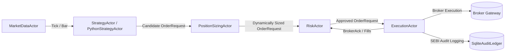

# honba-ya-actors: Asynchronous Actor Runtime & Supervision Tree

`honba-ya-actors` provides the institutional asynchronous actor runtime for high-throughput Indian equity and derivatives algorithmic trading. Built on top of Tokio, it enforces strict separation of concerns, zero-I/O domain gating, deterministic position sizing, and isolated polyglot execution.

---

## 1. Actor Supervision Topology & Pipeline

The trading pipeline is organized as an Erlang/OTP-style supervision tree supporting `OneForOne` and `AllForOne` restart strategies:



### Core Supervised Actors
1. **`MarketDataActor`**: Ingests market data feeds (ticks and bars), manages symbol subscriptions, and enforces backpressure policies (`CoalesceLatest`, `Passthrough`, `DropNewest`, `DropOldest`).
2. **`StrategyActor` / `PythonStrategyActor`**: Context-driven strategy runners that react to market events and generate candidate trading intents.
3. **`PositionSizingActor`**: Sits between Strategy and Risk; executes dynamic, portfolio-aware position sizing based on real-time equity and risk budgets.
4. **`RiskActor`**: Wraps the synchronous pre-trade `honba-mon::RiskEngine` ($< 15\,\mu\text{s}$ evaluation) enforcing SEBI capital limits, price bands, and order-to-trade ratios (OTR).
5. **`ExecutionActor`**: Interfaces asynchronously with broker adapters (`honba-te-core::BrokerExecutor`), manages idempotency via OMS state machines, records audit events, and dispatches wire requests.

---

## 2. Pipeline Service Level Objectives (SLOs)

Under institutional electronic trading requirements and SEBI regulatory standards, `honba-ya-actors` enforces strict latency and throughput invariants:

| Pipeline Stage | Target Metric / Invariant | Threshold ($p99$) | Verification Mechanism |
| :--- | :--- | :--- | :--- |
| **Market Data Broadcast** | Inbound feed tick to WebSocket client broadcast | $< 2\,\text{ms}$ | `verify_ws_broadcast_slo` |
| **Strategy Signal Generation** | Tick/Bar arrival to Candidate Order Request | $< 1\,\text{ms}$ | `verify_strategy_signal_slo` |
| **Pre-Trade Risk Gate** | Synchronous OTR and price-band evaluation | $< 15\,\mu\text{s}$ | `verify_risk_gate_slo` |
| **End-to-End Execution** | Tick arrival to broker wire socket dispatch | $< 5\,\text{ms}$ | `verify_wire_dispatch_slo` |

### Prometheus Metrics
The actor runtime exports institutional telemetry matching Prometheus standards:
- `actor_mailbox_queue_depth{actor}`: Gauge of pending messages in actor mpsc channels.
- `actor_processing_latency_seconds{actor}`: Histogram of per-message actor turnaround latency.
- `actor_backpressure_drops_total{actor, reason}`: Counter of coalesced or dropped ticks during market bursts.
- `actor_errors_total{actor, error_kind}`: Counter of actor task errors and supervisor restarts.
- `honba_order_dispatch_duration_seconds`: Histogram of broker placement latency.
- `honba_risk_evaluation_duration_seconds`: Histogram of pre-trade risk evaluation turnaround.

---

## 3. Position Sizing Actor & Chaining

The `PositionSizingActor` implements hexagonal decoupling via `honba_core::ports::PositionSizer`:
- Evaluates real-time portfolio cash and uncommitted equity via `honba_kokoro::sizing::evaluate_risk_budget`.
- Dynamically resizes candidate orders based on configurable models:
  - `FixedFractional`: Percentage of equity at risk per trade (e.g. 1–2%).
  - `VolatilityTarget`: ATR-scaled position sizing for risk parity.
  - `FixedNotional`: Constant rupee notional allocation per candidate.
- Declaratively configured in `step.toml` pipelines:
  ```toml
  [chain]
  pipeline = "signal -> size.fixed_fractional -> risk -> execute"
  ```

---

## 4. Python Strategy Actor Execution Model & Async Isolation

Python strategy scripts execute in a strictly isolated architecture that prevents GIL stalls and runtime panics from destabilizing the Rust Tokio runtime:

```
[Tokio Async Runtime]
        │
   StrategyMsg (mpsc channel)
        │
        ▼
[PythonStrategyActor]
   ├── Cooperative Async Boundary (tokio::time::timeout)
   ├── CancellationToken (task abort)
   └── Background Dedicated OS Thread ("honba-py-{algo_id}")
            │
       Blocking GIL Execution / pyo3
            │
            ▼
   OrderRequest / Error (oneshot reply)
```

### Key Execution Invariants
1. **Dedicated OS Thread**: Each Python strategy runs on a dedicated, pinned OS worker thread (`honba-py-{algo_id}`) rather than directly inside a Tokio worker thread.
2. **Cooperative Async Boundary**: Tasks cross into the thread worker via non-blocking channels with a strict timeout (`tokio::time::timeout`).
3. **Cancellation Tokens**: If the Python runtime hangs on GIL contention or slow math, the cancellation token triggers, and the Tokio actor does not block.
4. **Degraded State & Protective Kill Switch**: On timeout or unhandled exception:
   - Strategy state transitions immediately to `ActorStatus::Degraded`.
   - Supervisor is notified via error telemetry (`actor_errors_total{actor="python_strategy", error_kind="timeout"}`).
   - An emergency protective signal (`RiskMsg::HaltAlgo`) is dispatched to `honba-mon` to cancel open orders and prevent orphaned market risk.
